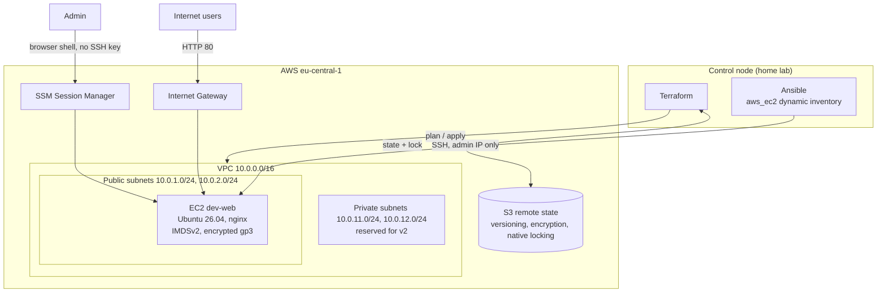
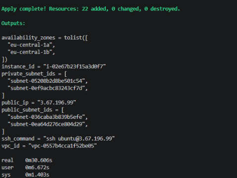
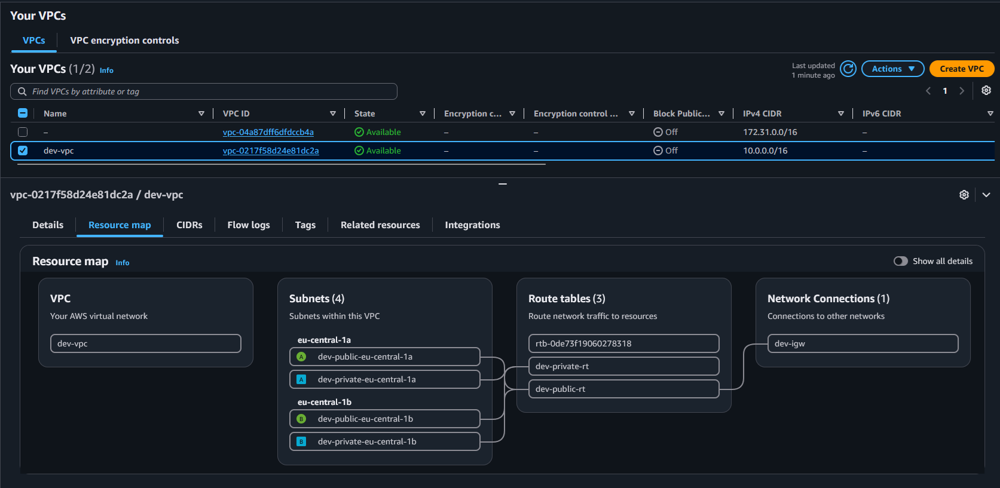
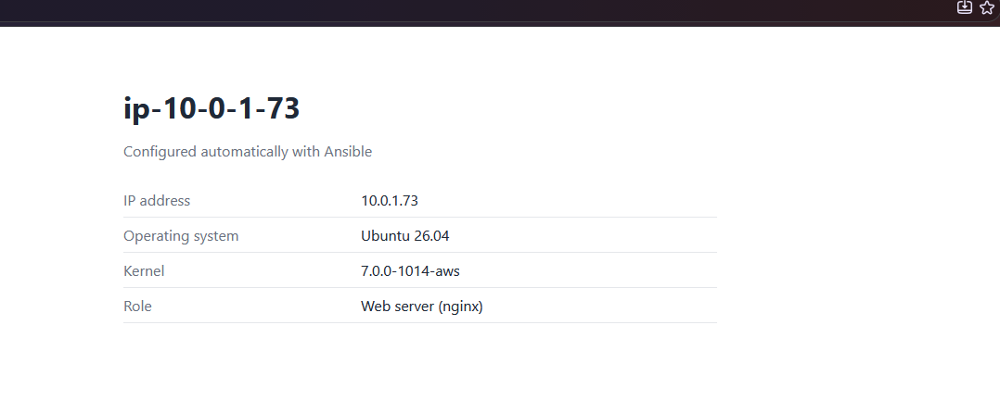
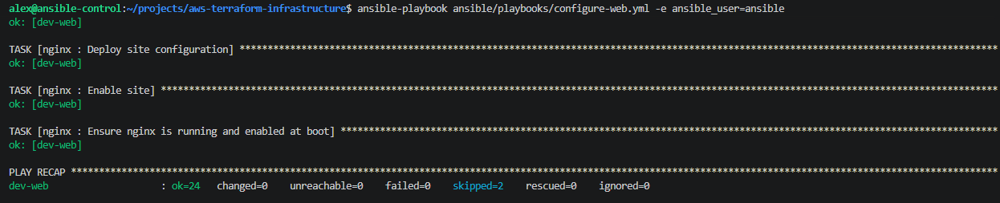

# AWS Terraform Infrastructure

[](https://github.com/alexpetrow/aws-terraform-infrastructure/actions/workflows/ci.yml)

AWS infrastructure as code with Terraform: VPC networking across two availability zones,
a hardened EC2 web server, IAM, and remote state in S3. The server is configured by the
Ansible roles from [infrastructure-automation-lab](https://github.com/alexpetrow/infrastructure-automation-lab).

> This is a learning and portfolio project in my own AWS account, not a production system.
> Resources are created for testing and destroyed afterwards. Simplifications and the
> production approach are documented in [Security](#security) and [Trade-offs](#trade-offs-and-next-steps).

## Business Problem

A small company wants to host a web application in AWS without building the environment
by hand in the AWS Console, where changes are slow, undocumented and hard to repeat.

This project defines the whole environment as code:

- **Reproducible:** the complete environment (22 resources) is created in about 30 seconds
  with one command and destroyed just as quickly.
- **Secure by default:** encrypted storage, IMDSv2, no long-lived access keys, SSH limited
  to the admin IP, security checks on every pull request.
- **Cost-aware:** no NAT Gateway, a single small instance, and an apply → test → destroy workflow.
- **Two layers:** Terraform provisions the infrastructure, Ansible configures the server.

## Architecture



## Features

- [x] Remote state in S3 with versioning, encryption, HTTPS-only policy, lifecycle rules and native locking
- [x] Reusable `network` module: VPC, public and private subnets in two AZs, route tables, locked default security group
- [x] Reusable `compute` module: EC2 with IMDSv2, encrypted gp3 volume, IAM role for SSM, restricted security group
- [x] Input validation guardrails (for example, SSH from `0.0.0.0/0` is rejected)
- [x] Short-term credentials only (`aws login`), no access keys
- [x] Ansible configuration with dynamic inventory based on resource tags
- [x] CI on every pull request: `terraform fmt`, `validate`, TFLint and Checkov; protected `main` branch

## Tech Stack

| Technology | Used for |
|---|---|
| Terraform | Infrastructure as code, modules, remote state |
| AWS | VPC, EC2, IAM, S3, SSM |
| Ansible | Server configuration with roles from infrastructure-automation-lab |
| GitHub Actions | CI pipeline and merge quality gate |
| TFLint | Terraform and AWS-specific linting |
| Checkov | Security and compliance scanning |

## Repository Structure

```
.
├── bootstrap/                  # Creates the S3 bucket for remote state (run once, local state)
├── modules/
│   ├── network/                # VPC, subnets, routing, default SG lockdown
│   └── compute/                # EC2, security group, IAM role, key pair
├── environments/
│   └── dev/                    # Uses the modules; S3 backend; example variables
├── ansible/
│   ├── inventory/
│   │   ├── aws_ec2.yml         # Dynamic inventory from AWS tags
│   │   └── group_vars/         # Variables for cloud hosts
│   ├── playbooks/configure-web.yml
│   └── requirements.yml
├── ansible.cfg
├── .tflint.hcl
├── docs/
│   ├── troubleshooting.md
│   └── images/
└── .github/workflows/ci.yml
```

## Architecture Decisions

| Decision | Choice | Reason |
|---|---|---|
| Region | eu-central-1 (Frankfurt) | Closest region with a full set of services |
| VPC CIDR | `10.0.0.0/16` | Does not overlap with the home lab (`192.168.88.0/24`), so a VPN can be added later |
| Subnets | 2 public + 2 private in 2 AZs | Network is ready for a load balancer and Auto Scaling in v2 |
| Subnet math | `cidrsubnet()` from the VPC CIDR | No hardcoded subnet addresses; works for any `/16` |
| NAT Gateway | Not used | About $35–40 per month even without traffic |
| Admin access | SSM Session Manager | No SSH keys or open ports for humans, sessions can be audited |
| Automation access | SSH from the admin IP only | Ansible needs SSH; port 22 is closed to the rest of the internet |
| State locking | S3 native lock file (`use_lockfile`) | Available since Terraform 1.10; no DynamoDB table needed |
| AMI | Latest Ubuntu 26.04 from Canonical's account, `ignore_changes = [ami]` | Trusted publisher; new AMIs do not force instance replacement |
| Roles | Reused from infrastructure-automation-lab | One source of truth for server configuration |

## Getting Started

### Prerequisites

- AWS account with an IAM user (not root) and MFA
- AWS CLI v2, Terraform >= 1.10, Ansible with `boto3` and `botocore[crt]`
- [infrastructure-automation-lab](https://github.com/alexpetrow/infrastructure-automation-lab)
  cloned next to this repository (Ansible roles are loaded from `../infrastructure-automation-lab/ansible/roles`)

### 1. Authenticate with short-term credentials

```bash
aws login
aws sts get-caller-identity
```

### 2. Create the state bucket (once)

```bash
cd bootstrap
cp terraform.tfvars.example terraform.tfvars   # set a globally unique bucket name
terraform init
terraform apply
```

Then set the same bucket name in `environments/dev/versions.tf` (backend blocks cannot use variables).

### 3. Create the environment

```bash
cd ../environments/dev
cp terraform.tfvars.example terraform.tfvars   # your public IP /32 and SSH public key
terraform init
terraform plan
terraform apply
```

### 4. Configure the server with Ansible

```bash
cd ../..
ansible-galaxy collection install -r ansible/requirements.yml
export ADMIN_CIDR="$(curl -s https://checkip.amazonaws.com)/32"

ansible-inventory --graph                                                    # instance found by tags
ansible-playbook ansible/playbooks/configure-web.yml -e ansible_user=ubuntu  # first run
ansible-playbook ansible/playbooks/configure-web.yml -e ansible_user=ansible # later runs
```

### 5. Verify and destroy

```bash
curl http://$(terraform -chdir=environments/dev output -raw public_ip)/health
terraform -chdir=environments/dev destroy
```

## Cost

Approximate on-demand prices in eu-central-1:

| Resource | Running 24/7 | 3-hour test session |
|---|---|---|
| EC2 `t3.micro` | ~$9 / month | ~$0.04 |
| Public IPv4 address | ~$3.6 / month | ~$0.02 |
| EBS gp3 10 GB | ~$1 / month | < $0.01 |
| VPC, subnets, IGW, route tables | free | free |
| S3 state bucket | cents | cents |

The environment is destroyed after each session. An AWS Budget sends alerts at 85% and 100%
of a monthly limit.

## Security

### Controls in place

- **Credentials:** `aws login` short-term credentials, rotated automatically. No access keys anywhere.
- **Instance identity:** IAM role with only `AmazonSSMManagedInstanceCore`; no credentials on the instance.
- **IMDSv2 required**, hop limit 1 (protects role credentials from SSRF attacks).
- **Encryption:** EBS volume and state bucket encrypted; state bucket denies non-HTTPS requests.
- **Network:** default security group stripped of all rules; SSH only from the admin IP,
  enforced by input validation; UFW on the host as a second layer.
- **State bucket:** public access fully blocked, versioning, `prevent_destroy`.
- **Secrets in Git:** `*.tfvars`, state files and `.terraform/` are ignored; only `.example` files are committed.

### Checkov findings accepted for the lab

Every accepted finding is skipped **in the code, next to the resource, with a reason**.

| Check | Requirement | Lab decision | Production approach |
|---|---|---|---|
| `CKV_AWS_126` | EC2 detailed monitoring | Extra cost; 5-minute metrics are enough | Enabled for critical systems |
| `CKV_AWS_88` | No public IP on EC2 | Web server is public in v1 | Instance in a private subnet behind a load balancer |
| `CKV_AWS_260` | Port 80 not open to the internet | Public web server by design | HTTPS terminated on a load balancer |
| `CKV2_AWS_11` | VPC Flow Logs | CloudWatch Logs cost | Enabled and shipped to central logging |
| `CKV_AWS_394` | Pinned availability zones | Only the first two zones of the sorted list are used, so new zones do not change the selection | Explicit zone IDs per environment |
| `CKV_AWS_144` | S3 cross-region replication | Not needed for a lab state bucket | Enabled for disaster recovery |
| `CKV_AWS_145` | S3 encryption with KMS | SSE-S3 avoids KMS key cost | Customer-managed KMS key |
| `CKV_AWS_18` | S3 access logging | Single user, no audit requirement | Enabled |
| `CKV2_AWS_62` | S3 event notifications | Not needed for state | As required |

## Testing and CI

| Check | What it catches |
|---|---|
| `terraform fmt -check` | Unformatted code |
| `terraform validate` (all modules and environments, without backend) | Syntax and reference errors |
| TFLint with the AWS ruleset | Invalid AWS values, unused declarations, missing version constraints |
| Checkov | Security misconfigurations |
| `terraform plan` before every apply | Unexpected changes |
| Second Ansible run with `changed=0` | Non-idempotent configuration |

The `main` branch is protected: changes go through pull requests and all three checks must pass.

## Real Issues Solved

Documented in [docs/troubleshooting.md](docs/troubleshooting.md), among others:

- **Ansible blocked by its own firewall rule:** overriding `ssh_args` disabled SSH multiplexing,
  and the UFW rate limit rejected the extra connections.
- **Silently ignored variables:** `group_vars` in the wrong directory made the roles use
  their defaults without any warning.
- **Short-term credentials with boto3:** `aws login` needs `botocore[crt]` for the dynamic inventory.

## Evidence

### Full environment in one command
22 resources (network, IAM, security, compute) created in about 30 seconds.



### Network created by Terraform


### Server configured by Ansible roles


### Idempotent configuration
The second run makes no changes.



## Trade-offs and Next Steps

| Current approach | Why | Next step |
|---|---|---|
| CI checks code only, without AWS access | No credentials needed for v1 | `terraform plan` in pull requests with GitHub Actions OIDC (no stored keys) |
| Public EC2 instance | Simplest working web server | Application Load Balancer + Auto Scaling group in private subnets |
| No NAT Gateway | Cost | VPC endpoints for AWS services; NAT only where required |
| Ansible roles loaded from a sibling repository | Simple reuse in a lab | Publish the roles as an Ansible collection |
| `AdministratorAccess` for the IAM user | Single-person lab | Least-privilege roles per task, IAM Identity Center |
| Firewall role adds rules but does not remove unmanaged ones | Avoids losing access mid-run | Controlled reset of rules with a safe ordering |
| Single `dev` environment | Learning scope | `staging` and `prod` using the same modules with different values |
